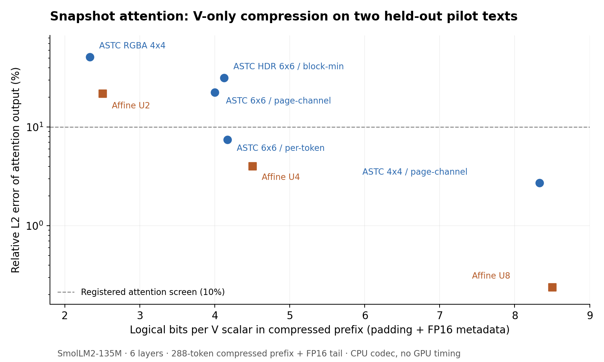
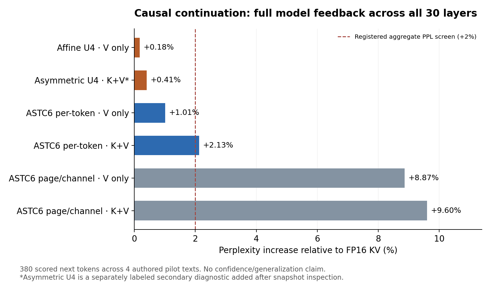

# ASTC-KV: первый исследовательский результат

**28 октября 2026 - версия 0.1 - CPU-пилот выполнен, Metal не выполнен**

## 1. Результат и решение

Создан и выполнен воспроизводимый численный стенд на настоящих Q/K/V
SmolLM2-135M. Найден ограниченный кандидат: **скалярный ASTC 6x6, отдельный
диапазон для каждого токена, только V**. В нашем пилоте он даёт 4,1667
логических бита на сжатый V-скаляр и увеличение aggregate perplexity на
1,0103% относительно FP16 KV. При этом два из четырёх текстов отдельно
превышают заранее выбранный порог +2%. Это основание продолжить проверку
данного представления, а не доказательство сохранения качества модели.

**Конкурентное преимущество ASTC пока не установлено.** При одинаковой
политике FP16 K + сжатый V + свежий хвост выигрыш логических байтов относительно
обычного U4 V составляет лишь 1,0733%. Более сильный асимметричный U4-контроль
для K+V в отдельном диагностическом прогоне дал меньший средний рост PPL и
намного меньший логический объём всего KV. Скорость всех этих режимов на
Apple GPU ещё не измерена.

Большинство первых ASTC-представлений оказалось непригодным под выбранный
порог: простая упаковка четырёх независимых каналов в RGBA, скалярный ASTC8x8,
HDR6x6 с минимумом блока и LDR6x6 с диапазоном на канал/страницу. Отрицательные
результаты сохранены. Разрабатывать быстрый GPU-кодировщик до аппаратной
проверки и уточнения представления преждевременно.

## 2. Фактическое окружение

| Параметр | Установлено |
|---|---|
| Среда выполнения | Linux x86-64; 9 доступных логических CPU |
| Python / NumPy | 3.12.14 / 2.3.5 |
| ASTC | Arm astcenc 5.7.0, официальный исходный код; библиотечный FP32 интерфейс |
| Encoder quality | 98, один поток на контекст кодировщика |
| Независимый reference | PyTorch 2.6.0+cpu, Transformers 4.51.3 |
| Apple GPU / macOS / Xcode / SDK | В этой среде отсутствуют; конкретный Mac пользователя не опрошен |
| MLX execution / GPU counters | Здесь недоступны; скрипты определения и измерения подготовлены |

Официальный кодек был собран локально. Вход в ASTC и программное
декодирование используют FP32 RGBA через библиотеку, без PNG или
промежуточного 8-битного изображения. Это исключает дополнительную U8
квантизацию и неявную смену правил ASTC decode на UNORM8. Эквивалентность
программного декодирования фактическому Metal-чтению всё равно требует Mac.
Проверенные хеши загрузок сохранены; сами веса и сторонние сборки в архив
не включены. См. `results/environment_linux.json` и manifests.

## 3. Ближайшие аналоги и граница новизны

Полная таблица из 14 работ - `docs/prior_art.md` и `.json`. Основные выводы:

| Работа | Сжатый объект и путь | Значение для ASTC-KV |
|---|---|---|
| Apple AFM 2025 | ASTC для серверных весов, аппаратное восстановление внутри tensor operations; KV отдельно 8-битный | Применение ASTC к нейросетевым тензорам и scalar min-shift уже известны |
| LLM.265 | Видеокодеки для весов, KV и других тензоров; NVDEC восстанавливает обычные тензоры | Нельзя заявлять новизной "аппаратный кодек для KV" |
| KVCodec | Предварительно закодированный удалённый KV -> NVDEC -> восстановление в paged KV vLLM | Удалённое reuse отличается от активного compressed-domain attention; layout/temporal structure уже исследованы |
| KIVI | Асимметричные направления квантизации K/V и свежий точный хвост | Асимметрия и tail сами по себе не новый вклад |
| TurboQuant / KVQuant / QuaRot | Преобразования, чувствительность ошибки, низкобитные представления | Общие идеи вращений и weighted error уже известны |
| Compute ASTC | Ограниченное GPU-кодирование ASTC во время исполнения | Перенос обычного ASTC encoder на GPU не достаточен для новизны |
| llama.cpp Metal | Реальные Q4/Q8 FlashAttention kernels, распаковка в вычислении | Обязательный сильный аппаратный baseline; D64 поддержан в проверенных исходниках |
| Open-TQ-Metal | Активный INT4 KV и fused Metal attention | Прямой compressed KV attention на Apple Silicon уже существует; интересен ASTC-specific путь |

Первичные источники: [Apple](https://arxiv.org/html/2507.13575v3),
[LLM.265](https://www.yongjiwu.me/assets/pdf/micro25-llm265.pdf),
[KVCodec v3](https://arxiv.org/html/2602.09725v3),
[KIVI](https://arxiv.org/html/2402.02750),
[TurboQuant](https://arxiv.org/html/2504.19874),
[Compute ASTC](https://niepp.github.io/2021/12/18/Compute-ASTC.html),
[Open-TQ-Metal](https://arxiv.org/html/2604.16957v1).

В Apple-описании 6x6 хранит 128 бит ASTC и дополнительный FP16 минимум:
3,56 бита payload превращаются в 4,00 бита на исходный scalar до прочих
расходов. Это нельзя представлять как полный 3,56-битный формат. Наш HDR
контроль заимствует только описанную трансформацию и не воспроизводит
закрытый Apple encoder, подготовку весов или адаптеры восстановления качества.

Open-TQ-Metal включён как существенный аналог, но его headline speedup не
принят за сопоставимую скорость. Статический аудит опубликованного кода
выявил слабый reference, несопоставимое timing и вопросы к causal prefill и
доказательству длинного end-to-end запуска. Детали и immutable ссылки находятся
в обзоре. Это аудит исходников, не наше аппаратное воспроизведение.

**Прямого аналога активного KV-кэша с прямым чтением ASTC в attention в
проверенных источниках не найдено. Мировое первенство не установлено.**
Возможный вклад остаётся в совместном представлении, ASTC-specific учёте
ошибки, реальном динамическом обслуживании и доказанном полезном режиме.

## 4. Исходная модель и проверка Q/K/V

Выбрана [HuggingFaceTB/SmolLM2-135M](https://huggingface.co/HuggingFaceTB/SmolLM2-135M),
ревизия `93efa2f097d58c2a74874c7e644dbc9b0cee75a2`. Конфигурация: 30 слоёв,
hidden576, Hq9, Hkv3, D64, max context8192, non-interleaved Llama RoPE,
theta100000. Это небольшая прозрачная модель для многократных проверок,
а не модель, на которой следует заключать о скорости большого local inference.

Исходные BF16 веса расширены в FP32 точно; веса одинаковы во всех вариантах.
NumPy forward сохраняет Q/K после RoPE, V до репликации GQA, позиции,
token IDs, layer IDs, логиты и SHA256. Проверка не опирается только на
самосогласованность: выходы RoPE и V projections перехвачены в отдельном
Hugging Face eager forward и сравнены на всех 30 слоях.

| Проверка, 384 настоящих токена | Максимальное абсолютное расхождение |
|---|---:|
| Q | 1,1125e-4 |
| K | 7,3433e-5 |
| V | 1,5557e-5 |
| Последние hidden states | 1,4782e-4 |
| Logits | 1,9073e-4 |

Все relative L2 <1,2e-6. Заранее заданные пороги max_abs<1e-3 и
relative_l2<1e-4 пройдены без ослабления. Отдельно пройдена проверка full
forward384 против prefill383+step на абсолютной позиции 383. Результаты:
`results/transformers_validation.json`.

## 5. Первый эксперимент: сохранённые Q/K/V

### Постановка

Четыре оригинальных англоязычных текста, по 384 токена; systems - настройка,
story - development, science и records - отложенный пилот. Это не финальные
тестовые данные и не публичный benchmark. Сохраняются слои 0,5,11,17,23,29,
все 3 KV-головы и 9 query-голов. Кодируется только префикс 0..287. Запросы берутся
на 16 позициях от 288 до 383. Оставшаяся часть кэша и несжатая сторона проходят
FP16-округление, causal mask исключает ещё недоступные токены.

Перебраны 8 ASTC-представлений и 5 обычных контролей, отдельно K-only/V-only/K+V:
936 записей по слоям с дополнительными per-head метриками. Зафиксированы
контекст, page96, seed, quality98, FP16 scale/offset, крайние padding-блоки,
память хвоста и критерии. Основная ошибка:

`relative_L2 = sqrt(sum((attention_test-attention_ref)^2) / sum(attention_ref^2))`.

Скрининг: <=10% по этой метрике, mean KL<=0,01 и не больший логический объём,
чем U4 с той же политикой сжатия. Это критерий выбора кандидата, не заявление
о полезности модели. Исходная конфигурация: `configs/pilot_v1.json`.

### Численные результаты на двух отложенных текстах

Таблица для **V-only**, K остаётся FP16. Биты в третьем столбце относятся
ко всему K+V при 384 токенах, включая несжатый 96-токенный хвост.

| Представление V | Бит/сжатый V scalar | Бит/полный KV scalar | Relative L2 attention |
|---|---:|---:|---:|
| U4 affine, token group64 | 4,5000 | 11,6875 | 4,04% |
| ASTC scalar6x6, per-token | 4,1667 | 11,5625 | **7,43%** |
| ASTC scalar6x6, page/channel | 4,0000 | 11,5000 | 22,55% |
| ASTC scalar6x6 HDR, block minimum | 4,1250 | 11,5469 | 31,64% |
| ASTC RGBA4x4, page/channel | 2,3333 | 10,8750 | 51,52% |
| ASTC scalar8x8, page/channel | 2,3333 | 10,8750 | 49,34% |
| ASTC scalar4x4, page/channel | 8,3333 | 13,1250 | 2,71% |
| U8 affine, token group64 | 8,5000 | 13,1875 | 0,24% |

У per-token ASTC6x6 p95 ошибки по query-головам 16,20%, максимум 28,44%.
У U4 соответствующие значения 10,63% и 14,87%. Агрегат скрывает существенную
неоднородность голов. Совместное K+V ASTC6x6/token имеет 14,79% ошибки и
mean KL0,0354, поэтому attention-критерий не проходит.

Простой асимметричный U4: K по каналам через 96 токенов, V по 64 каналам токена,
даёт K+V relative L2=6,65% и mean KL=0,00631 при 7,3125 бит/полный KV scalar.
Это численный affine baseline, а не точное воспроизведение KIVI или MLX.

### Что можно объяснить

На этих данных выбор группировки диапазона для V важнее небольшого изменения
номинального числа бит: переход page/channel -> token резко уменьшает ошибку.
Это совместимо с различной чувствительностью и распределениями K/V, известными
из KIVI, но ещё не показывает новую общую закономерность ASTC.

Провал простого RGBA согласуется с ограниченной геометрией цветовых endpoints
и общими interpolation weights. Причина пока не доказана: могут влиять
распределение, padding, нормализация и поиск encoder. Высококачественный
software encoder - благоприятный контроль, не абсолютный оптимум ASTC.

Перестановки каналов и токенов внутри страницы не обнаружили улучшения,
устраняющего основной провал page/channel. Но перестановка внутри страницы
меняет состав ASTC-блоков, поэтому она не изолирует локальные распределения
от пространственного порядка. Следующий контроль должен переставлять значения
внутри фиксированного блока при неизменных metadata и границах.

## 6. Второй эксперимент: модель с накоплением ошибок

После чистого prefill288 получены кэши всех 30 слоёв. Старый префикс кодируется
один раз. Продолжение использует настоящие новые hidden states, Q/K/V и
изменённую историю. Новые значения хвоста округляются в FP16. Измерены
95next-token предсказаний на каждый текст, targets289..383; target288
исключён, поскольку предсказан до сжатия. Всего 380 оцениваемых токенов.

Основной список методов зафиксирован до выполнения модельной серии.
Per-token вариант добавлен по результату **только tune systems**, с сохранением
неудачного page/channel. Для secondary asymmetric baseline создана отдельная
запись после просмотра snapshot результатов; он не выдан за первичный тест.

| Метод | Рост aggregate PPL | Бит/полный KV scalar при последнем предсказании |
|---|---:|---:|
| FP16 | 0% | 16,0000 |
| U4 token, только V | +0,181% | 11,6762 |
| U4 token, K+V | +2,828% | 7,3525 |
| ASTC6 page/channel, только V | +8,866% | 11,4883 |
| ASTC6 page/channel, K+V | +9,599% | 6,9765 |
| **ASTC6 token, только V** | **+1,010%** | **11,5509** |
| ASTC6 token, K+V | +2,128% | 7,1018 |
| U4 asymmetric, K+V - secondary | +0,410% | 7,2898 |

Последнее предсказание использует 383 токена: prefix288+tail95. Поэтому
числа памяти отличаются от snapshot с 384 токенами. Это логический расчёт
представления; CPU-прототип хранит полные декодированные копии.

### Неоднородность результата

| Текст | ASTC6 token V-only: рост PPL |
|---|---:|
| systems, настройка | +2,2634% |
| story, development | +2,0736% |
| science, pilot holdout | +0,2267% |
| records, pilot holdout | -0,4948% |

Агрегат проходит 2%, первые два текста отдельно не проходят. Отрицательное
изменение PPL на одном коротком тексте не означает улучшение модели. Вторичный
asymmetric U4 тоже имеет один текст чуть выше 2%. Данных недостаточно для
устойчивого вывода о сохранении качества у любого нового метода.

Выполнены четыре собственные greedy-генерации story по 32 токена. Каждая
использует свою историю после общего первого токена. Тексты/ID сохранены;
доля совпадающих токенов не интерпретируется как качество задачи. Нет
подтверждающего retrieval/multi-fragment benchmark, второй модели, длинного
контекста или повторного кодирования новых страниц.

## 7. Память без номинальных сокращений

Для D64, scalar6x6: ширина текстуры 66. Фактический payload равен
`128*11/(6*64)=3,6667`бит/скаляр. Per-token offset+scale в FP16 добавляют
`32/64=0,5`, итого 4,1667. При FP16 K получаем 10,0833 бит/общий KV scalar
даже без хвоста; это не "4-битный KV-кэш".

В последнем модельном предсказании ASTC V-only требует 6 370 560 логических
байт против 6 439 680 у U4 V-only: экономия 69 120 байт, **1,0733%**.
Asymmetric U4 K+V требует заметно меньше. Таким образом, сравнение только с
FP16 создало бы чрезмерно благоприятное представление о достигнутом результате.

Не измерены: physical ASTC allocation, Metal metadata allocation, encode
workspace, staging, overlap lifetimes, полная пиковая память процесса. В
неподтверждённом Metal probe предусмотрены `allocatedSize`, buffer lengths,
staging pitch, control bytes и diagnostics-only RSS. Его одновременно живущие
контроли не будут выданы за производственную память ASTC runtime.

## 8. Аппаратный путь: реализованные исходники

Подготовлены Objective-C++ host и Metal split-context attention с online
softmax и merge. Они загружают готовые блоки в private ASTC textures через
buffer->texture blit, читают texel по целочисленным координатам и применяют
FP16 affine metadata внутри вычисления. Поддержаны scalar/RGBA, 4x4/6x6/8x8,
GQA, FP16 K + ASTC V, оба вида диапазонов и D<=128 кратный 4.

Перед timing отдельный diagnostic kernel восстанавливает фактические GPU
значения. На них CPU считает reference attention, чтобы отделить ошибку
кодека от ошибки нового ядра. Сам timed ASTC attention не разворачивает
полный кэш. Сравниваются ASTC texture, обычная texture с той же адресацией и
FP16 buffer на соответствующих восстановленных значениях. Это диагностические
контроли, а не сильные оптимизированные runtime baselines.

Публичный [Metal Feature Set Tables](https://developer.apple.com/metal/Metal-Feature-Set-Tables.pdf)
и Apple API допускают поддерживаемое ASTC-чтение и копирование заранее
закодированных блоков. Storage write в ASTC как в обычный тензор не предполагается.
Копирование не является кодированием. Возможности конкретного GPU, SDK,
корректность MSL и скорость должны быть подтверждены запуском.

Два настоящих fixture уже включены в `results/metal_fixtures/`. Команда
`bash scripts/run_mac_probe.sh` делает первый аппаратный запуск без скачивания
весов. Маленький 384-токенный fixture предназначен для correctness, не для
проверки bandwidth на длинном контексте.

## 9. Статусы гипотез и этапов

| Вопрос | Статус по текущим данным |
|---|---|
| Реальные Q/K/V и causal model reference | Реализовано, выполнено, проверено независимо |
| H1: существует полезный численный ASTC-режим | Ограниченный V-only кандидат есть; устойчивое качество и конкурентность неопределённы |
| Простая RGBA4x4 упаковка при ~2,33 бита | Опровергнута в данной конфигурации и пилотных данных |
| LDR6x6 page/channel как основной V-режим | Выбранный порог не проходит; ветка не продолжается без нового объяснения |
| H2: attention-sensitive encoder | Запланировано; не реализовано и не проверено |
| H3: аппаратный путь быстрее сильных базовых | Неопределённо; исходники есть, GPU не выполнен |
| H4: динамическое кодирование окупается | Запланировано; нет GPU encoder, обновлений страниц или измерений |
| Интеграция MLX / повторное сжатие новых страниц | Запланировано |
| Несколько моделей / финальный benchmark / открытие | Не выполнено, претензий нет |

## 10. Следующие различающие эксперименты

1. **Mac correctness и precompressed cost.** Запустить готовый fixture,
   подтвердить аппаратное чтение, сверить CPU/GPU decode и attention на тех
   же значениях. Потом расширить working set до длинных контекстов в пределах
   prompt+continuation<=8192. Если даже благоприятный режим проигрывает,
   обычная texture и FP16 buffer помогут отделить texture access/addressing
   от codec overhead. После этого сравнить MLX fast SDPA и llama.cpp Q4/Q8.
2. **Представление до нового encoder.** Изолировать эффект диапазонов token
   vs channel и ошибки важных голов. Проверить ASTC block interpolation
   residual, line-fit residual для RGBA и корреляцию ошибки V с attention.
   Нужны контроль внутри фиксированных блоков, предсказание на новых слоях
   и сравнение с простой нормой/размахом как альтернативным объяснением.
3. **Новая явно сформулированная гипотеза для смешанного режима.** K с
   обычной низкобитной квантизацией + ASTC только выбранных V-голов/слоёв
   может сохранить качество и уменьшить decode compute. Проверять по одному
   изменению, учитывать индексы/ветвления и сравнивать с asymmetric U4.
4. **Модельный тест достаточной мощности.** Заморозить новый corpus и
   прикладные задачи, проверить гораздо больше токенов, длинный контекст и
   вторую модель. Продолжить собственную генерацию достаточно долго, чтобы
   кодировать новые страницы. Не калибровать на текущем pilot holdout.
5. **GPU encoder только после положительных качественного и аппаратного
   контролей.** Ограничить ASTC modes под выбранные данные, измерить качество
   нового encoder отдельно от offline98, затем включить blit/tail/sync в
   полный request. Правило окупаемости должно использовать доступную историю,
   а не будущую длину генерации.

Приближённая проверка H4: число последующих чтений страницы * экономия на
одном чтении должно превышать **неперекрытую** стоимость подготовки страницы.
При полезном overlap нельзя складывать все GPU durations. Общая польза
дополнительно ограничена долей attention во всём decode - её ещё необходимо
измерить. Проектные 20% decode speedup /25% memory reduction пока не достигнуты.

## 11. Воспроизводимость и проверки

В архиве: исходники, конфигурации до результатов,14-source таблица, формат,
capture tool, offline codec bench, model quality runner, Metal probe, сырые
936snapshot rows,2660primary losses,380secondary losses,4 генерации, captures,
метаданные, fixtures и графики. Код и данные сопровождаются SHA256 manifest.

Выполнены 7 целевых тестов: causal GQA против независимого scalar oracle,
identity codec для 8 раскладок, metadata coverage, точные payload+padding bytes,
отклонение незавершённых страниц, настоящий ASTC constant roundtrip и
bit-packed affine sizes. Дополнительно проверены сборка CPU codec, Python
syntax, shell syntax и HF reference. Metal compilation/testing не выполнены.

Один capture был обнаружен неполным; он атомарно восстановлен и его SHA256
точно совпал с первоначальным ожидаемым. Ошибка и повтор сохранены. Runtime
версия model-quality скрипта архивирована отдельно: переименование accessor
`resident_bytes`->`logical_bytes` после запуска не меняло арифметику, исторический
hash не заменён. Подробности в соответствующих result notes.

Текущий полезный результат - проверенный стенд, количественно ограниченный
ASTC-кандидат и несколько опровергнутых простых представлений. Научная новизна,
физическая экономия памяти и ускорение остаются отдельными открытыми вопросами.
